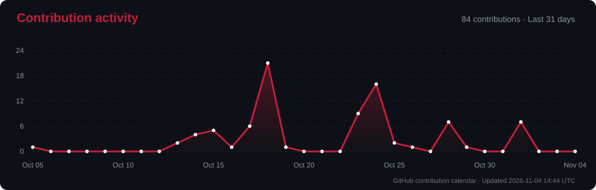

# Arda Karataş

Open-Source Developer & Product Builder

  

<!-- TOP ROW: STATS & MOST USED LANGUAGES (NO ICONS, RED ACCENT) -->
&nbsp;&nbsp;

  

<!-- MIDDLE ROW: STREAK STATS (RED ACCENT) -->

 

---

### ⚡ Projects

<table>
  <tr>
    <td width="33%" valign="top">
      <h3><a href="https://github.com/ardakrt/authly">Authly</a></h3>
      
Windows-first, secure offline desktop authenticator designed for privacy, speed, and reliability.

      
<code>TypeScript</code> • <code>Desktop App</code> • <code>Security</code>

    </td>
    <td width="33%" valign="top">
      <h3><a href="https://github.com/ardakrt/strmly-player">Strmly Player</a></h3>
      
Modern, responsive web-based video and media player interface built for smooth streaming performance.

      
<code>TypeScript</code> • <code>Media Player</code> • <code>Web</code>

    </td>
    <td width="33%" valign="top">
      <h3><a href="https://github.com/ardakrt/ardakaratas.com.tr">Portfolio</a></h3>
      
Personal digital business card and minimalist portfolio built with React & Tailwind CSS.

      
<code>React</code> • <code>TailwindCSS</code> • <code>Web</code>

    </td>
  </tr>
</table>

 

<!-- BOTTOM ROW: ACTIVITY GRAPH -->

  

Connect with me &nbsp;•&nbsp; <a href="https://github.com/ardakrt">GitHub @ardakrt</a> &nbsp;•&nbsp; <a href="https://ardakaratas.com.tr">ardakaratas.com.tr</a>

